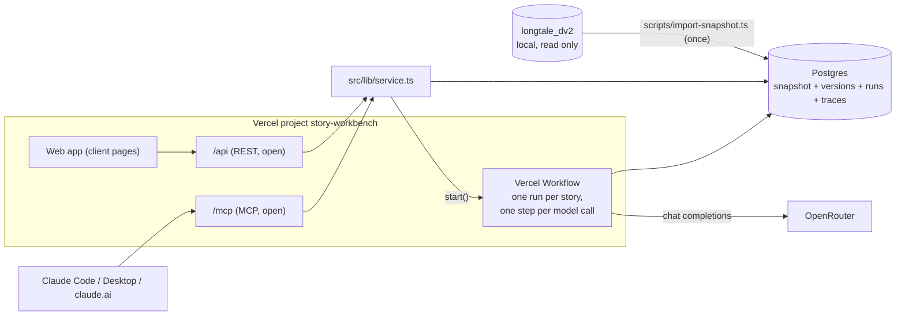

# Architecture

Story Workbench is one Next.js app on Vercel: the web app, the REST API, the
MCP server and the background runs. It reads one hosted Postgres database.

## Folders

| Folder | What it holds |
|---|---|
| `src/lib/writer/` | Code ported from longtale-core 136fa4ac: the fact ledger, the writer helpers, the code checks, `llm-reasoning`, and `harness.ts` (payload, split, selection, statistics, headline fit). |
| `src/lib/social/`, `src/lib/ad/` | The social post and display ad copy prompt builders and parsers, ported line for line. |
| `src/lib/engine/` | The workflow engine: types, templates, the filter format, the code registry, rendering, the OpenRouter call, and `step.ts` (one step, with its trace). |
| `src/lib/seeds/` | The three seed versions, built from `prompts/` (the production prompt files as git blobs). |
| `src/lib/runs/` | Run creation, the cost estimate, the durable execution (`exec.ts`), the results summary and the exports. |
| `src/workflows/story.ts` | The Vercel Workflow: `storyWorkflow(runStoryId)`. |
| `src/lib/service.ts` | One service layer for the web app, the REST routes and the MCP tools. |
| `src/app/api/**` | REST routes and `/api/openapi.json`. |
| `src/app/mcp/route.ts` | The MCP server (17 tools and the `workbench://guide` resource). |
| `src/app/**/page.tsx` | The pages of spec §6. |
| `scripts/` | Import, seeds, goldens, fixture inputs, the MCP smoke test. |
| `test/` | Engine unit tests and the fidelity test with its goldens. |

## The engine

A version is `{ steps, settings }`. A step is a `prompt` step (system and user
templates, model, temperature, max tokens, reasoning, format) or a `code` step
(a registry function and parameters). Each step declares `inputs`, `outputs`
and an optional `when` (filter clauses on the context).

The context starts with the story inputs: `story`, `org`, `brand`, `pages`,
`other_pages`, `crawl_rows` and `settings`. Each step adds its outputs. A
template token `{{name.path}}` reads the context; a value that is not text
needs `|json`, `|json1` or `|json2`. A save stops when a token, an input or a
`when` field names a value that no story input or earlier step makes.

## A run

1. `POST /api/runs` (or the MCP `start_run`) writes the run and one
   `run_stories` row per story, then starts up to `concurrency` story workflows.
2. `storyWorkflow` loops: `advanceStep` loads the version and the story inputs,
   runs code steps inline (or skips them by `when`), and stops at the next model
   call; `modelCallStep` renders that prompt, calls OpenRouter and stores the
   trace and the output. Each model call is its own durable step, so a long
   call never meets a request time limit.
3. When a story ends, `finishStep` claims the next pending story and starts its
   workflow, then closes the run when no story is left.
4. A cancelled run stops at the next step boundary of each story.

## Tables

Snapshot (replaced by the import): `jobs`, `organizations` (with the brand
profile as JSON), `stories` (with the derived and ranking columns), `pages`,
`story_pages`, `images`, `story_images`.

App (never touched by the import): `families`, `versions`, `runs`,
`run_stories`, `traces`, `saved_filters`, `settings`.

## Fidelity

`scripts/make-goldens.ts` runs longtale-core's own builders on four fixture
stories and writes `test/goldens/<seed>/job-<id>.json`: every prompt step's
messages and settings, and the recorded model replies.
`scripts/export-fixture-inputs.ts` writes the app's own story inputs for the
same stories. `test/fidelity.test.ts` runs each seed on those inputs, replays
the recorded replies, and requires every message and setting to be equal. CI
runs it without longtale-core or a database.
